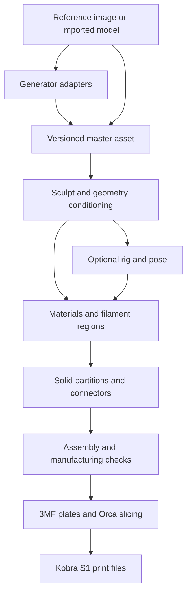

# AI Slicer and Modeling Studio — research and recommendation

Research date: October 8, 2026. Target: Windows, Anycubic Kobra S1, local AI, with potential future distribution.

Implementation follow-up: the user selected **TRELLIS.2** for the new project. The current build uses native Windows trellis.cpp Q8 and the installed Anycubic Slicer Next engine, with Kobra S1 profiles. The recommendations below retain the research sequence; they are not the current setup instructions. See [README](<C:/AI/AI Slicer/README.md>), [migration assessment](<C:/AI/AI Slicer/docs/MIGRATION.md>) and [validation results](<C:/AI/AI Slicer/docs/VALIDATION.md>) for implemented behavior and test evidence. DINOv3 carries separate Meta terms, so the complete generator stack is not wholly MIT.

Follow-up refinement: newer model/runtime research below expands the initial shortlist. **Test TRELLIS.2 through a lower-memory runtime for a quality upgrade; evaluate Pixal3D next for reference fidelity.** TripoSG remains the simpler hardware baseline. The official TRELLIS.2 24 GB requirement does not cover every community implementation.

## Recommendation

Build a print-focused modeling and assembly studio around **Orca slicing, Blender modeling/posing, and a dedicated color-to-solid partitioning system**. Preserve the useful Hunyuan workers behind interchangeable generator adapters. Benchmark **TripoSG and PartCrafter** first on your existing GPU. Develop the color separation and connector workflow before attempting a complete Substance/Blender replacement.

The strongest differentiator is: **turn a textured or painted model into a small number of printable, single-color solids that fit together, with editable joints and an assembly preview**. Generation, texturing, modeling, and slicing already have substantial existing implementations; this connection between them needs the most custom engineering.

Orca's current development changes the integration decision: its documentation now describes an experimental parametric Design tab and Python plugins. Test an extension first, retain a standalone companion application as the fallback, and fork only when necessary capabilities cannot be exposed through the available interfaces. [Design tab](https://www.orcaslicer.com/wiki/design/design_tab), [plugin architecture](https://www.orcaslicer.com/wiki/developer_reference/plugin_development/plugin_system), [plugin source directory](https://github.com/OrcaSlicer/OrcaSlicer/tree/main/src/slic3r/plugin).

This is a source/configuration/log audit and primary-source research review. I did not rerun generation, test the researched applications, measure model quality, or print fit samples. Repository capabilities are candidates for validation, not guarantees.

## 1. Your existing installation

Inspected `C:\Users\wgray\Documents\Hunyuan3D Rig Studio`: README, roadmap, third-party notices, configuration, application orchestration, CLI, job store, mesh repair/preflight, UniRig worker, representative output QA, and existing logs. `C:\AI\AI Slicer` was empty at inspection.

### What is useful to retain

- Local Flask application, image masking through BiRefNet, Hunyuan3D 2.1 shape/PBR painting, MIA and UniRig worker integrations.
- Separate inference/export processes that address Windows native-library collisions.
- Mesh and export validation, conservative treatment of disconnected accessories, and preservation of textures during safe repairs.
- Pose/weight inspection and adjustment, animation retargeting, turntable rendering.
- CLI and SQLite-backed batch infrastructure, model cache management, local third-party notices.

Local evidence: [README](<C:/Users/wgray/Documents/Hunyuan3D Rig Studio/README.md>), [repair worker](<C:/Users/wgray/Documents/Hunyuan3D Rig Studio/mesh_repair_worker.py>), [rig worker](<C:/Users/wgray/Documents/Hunyuan3D Rig Studio/digital_forge_unirig_worker.py>), [CLI](<C:/Users/wgray/Documents/Hunyuan3D Rig Studio/cli.py>).

### Findings that affect the new suite

| Finding | Evidence and implication |
|---|---|
| Repair does not reconstruct the object | The current repair policy removes invalid, degenerate and duplicate faces, bounded micro-floaters, and safe winding errors. It explicitly disables global hole filling. It cannot rebuild fused fingers, recover missing anatomy, produce deformation loops, or infer printable part interiors. |
| Rigging failures are recorded | `workspace/logs/rigging.log` includes repeated rejection of malformed Mixamo-template decodes, with varying bone counts, and a failure after twelve attempts in a historical run. It also records a pose-to-rest fallback because 2,560 faces stretched more than fivefold. These are observed failure classes; the log does not prove their complete cause. |
| A structurally valid rig can still deform badly | One existing detailed QA report has one root, normalized weights, four influences maximum and zero unweighted vertices, with 30 finger bones collapsed to a 22-bone export. Such checks establish structural properties, not anatomically correct joints or good animation. |
| Persistence is only partly integrated | `cli.py` imports and uses `JobStore`; `app.py` declares `jobs = {}` and uses a threading lock. The README's statement that web and CLI jobs share persistent state and atomic GPU reservation is not supported by the inspected web code. Unify orchestration before adding more heavyweight workers. |
| Existing roadmap is partly stale | Its claims of no CLI/batch and no persistent state are outdated for the CLI. Its identification of missing conditioning stages remains useful, but should not be treated as a current code audit. |
| Manufacturing preparation is missing | No dedicated application stage for physical wall thickness, color-region solid construction, connector authoring, 3MF paint interchange or slicing was found in the inspected top-level pipeline. |

Important interpretation: older repair QA reports count boundaries on textured meshes without the newer seam-aware projection. Duplicated vertices at UV seams can look like boundaries to a naive counter. A recorded count of 9,990 boundary edges is **not sufficient evidence of 9,990 physical holes**.

The hardware query reports **NVIDIA GeForce RTX 4090 Laptop GPU, 16,376 MiB VRAM**. This is a 16 GB laptop configuration, which materially affects generator choices.

### Separate print preparation from animation preparation

For printing, prioritize closed solids, minimum thickness, dimensions, usable contact surfaces, support-aware orientation, and connector fit. Dense triangles can print well; quads are not a print requirement.

For animation, prioritize usable joint placement, appropriate topology where deformation happens, clean skin weights, controllable rest pose, and tests across a pose set. Retopology can help, but does not automatically fix a bad skeleton or fused geometry.

For a posed figurine, pose the character first, freeze deformation into geometry, then construct printable solids and assembly joints. For an articulated physical figure, model mechanical joints explicitly; a digital skeleton does not supply printable hinges or ball joints.

## 2. Review of your current slicer: Anycubic Slicer Next

Local executable: `C:\Program Files\AnycubicSlicerNext\AnycubicSlicerNext.exe`, file/product version **2.0.0.3**. Data under `%APPDATA%\AnycubicSlicerNext` includes your Kobra S1 profiles and custom PLA/silk/process presets. Cura and Orca configuration directories are also present; their presence alone does not establish current use.

The local S1 0.4 mm machine profile specifies a 250 × 250 × 250 mm printable volume and Klipper-flavor output. It includes custom start/layer/tool-change behavior. Preserve the complete profile bundle, its inheritance, and filament overrides when comparing engines. Selecting generic Klipper is insufficient to reproduce these settings.

Anycubic's public repository identifies Next as an Orca derivative and declares AGPLv3. Its principal value for your situation is vendor-specific printer integration and settings. The public source exists, but I did not establish that its current revision exactly corresponds to your installed binary. [Official repository](https://github.com/ANYCUBIC-3D/AnycubicSlicerNext), [official usage guide](https://wiki.anycubic.com/en/software-and-app/new-page-anycubic-slicer-beta%28orca-version%29/anycubic-slicer-next-slicing-software-quick-start-guide).

My assessment: keep it as the reference for successful S1 output and device behavior. It is not the strongest starting point for a general modeling/AI suite: integrating vendor networking is a separate concern from modeling and manufacturing geometry, and tracking upstream Orca improvements through another fork adds work.

Do not equate support for slicing an S1 with support for its stock LAN upload, camera, ACE inventory or cloud controls. Validate those independently. The initial single-color assembly workflow can use exported print files and does not depend on ACE or firmware modification.

## 3. Orca review and integration options

The official latest-release URL resolved to **v2.4.2** at research time. Upstream includes an S1 0.4 mm profile. Its established strengths include calibration, advanced wall/seam/support controls and multimaterial workflows. [Release](https://github.com/OrcaSlicer/OrcaSlicer/releases/tag/v2.4.2), [project](https://github.com/OrcaSlicer/OrcaSlicer), [Anycubic profiles](https://github.com/OrcaSlicer/OrcaSlicer/tree/main/resources/profiles/Anycubic/machine).

The cut-tool source exposes planar/dovetail modes and plug, dowel and snap connectors with several cross sections. This is valuable existing assembly functionality. It does not establish a general automatic conversion of arbitrary painted surface regions into mutually fitting solids. [Cut implementation](https://github.com/OrcaSlicer/OrcaSlicer/blob/main/src/slic3r/GUI/Gizmos/GLGizmoCut.cpp).

The **experimental Design tab** is documented for nightlies or releases **greater than 2.4.2**, off by default. It supports sketch-based parametric solids and stores the construction recipe inside a 3MF project. Treat it as a development candidate rather than an installed stable capability. It does not replace Blender's organic sculpting, rigging and animation workflows. [Design documentation](https://www.orcaslicer.com/wiki/design/design_tab).

Orca also documents embedded Python plugins for scripts, slicing-pipeline hooks and printer connections. Before adopting these, verify availability in the exact chosen build and whether the exposed API allows reading/editing geometry, paint labels, objects and undo history. A slicing callback alone may not support a full modeling workspace. [Plugin documentation](https://www.orcaslicer.com/wiki/developer_reference/plugin_development/plugin_system).

| Approach | Assessment |
|---|---|
| Orca extension + external AI/geometry workers | First feasibility experiment. Reuses the slicer and can reduce fork maintenance. Depends on actual model-editing API coverage. |
| Standalone studio + versioned Orca interchange | Recommended fallback and a practical prototype. Gives control over the modeling UI, with explicit import/export validation. A seamless embedded slicer is additional work. |
| Orca fork | Reasonable for a deeply unified open-source desktop suite if extension points prove insufficient. Requires C++/GUI build expertise, upstream merging and AGPL compliance. |
| Blender add-on + Orca | Fast route to serious sculpt/pose/repair functionality. Strong prototype path; harder to deliver your preferred focused interface. |
| New slicing engine | Highest engineering burden. No identified user requirement justifies replacing Orca's toolpath engine initially. |

Related printer projects: [Rinkhals](https://github.com/rinkhals-community/Rinkhals) includes S1 support and is relevant to optional printer integration; compatibility depends on firmware. [OrcaCubic](https://github.com/marcodiniz/OrcaCubic) demonstrates native Anycubic LAN/ACE integration, but its advertised target is Kobra X. Do not assume its networking works on S1.

## 4. Closest projects to your color/assembly workflow

| Project | Relevance | License / limitation |
|---|---|---|
| [Split3MF](https://split3mf.com/) | Direct product comparison: painted-color separation, selectable capping strategies, interlocking, prism/cylinder connectors and socket tolerance. | Free access is not evidence of an open-source license; use as a functional reference until reuse rights are established. |
| [3MF Paint Split](https://github.com/EllsworOpan/3mfPaintSplit) | Local web app for cuts while retaining paint assignments; documents handling Orca/Bambu and Prusa paint representations, transforms and external components. | MIT; young project. Validate on your files before borrowing code or trusting output. |
| [DitherForge](https://github.com/rtwfroody/ditherforge) | Textured GLB/OBJ/etc. to filament-colored 3MF; also plane splits, pegs, dowel/magnet pockets and tolerance controls. | MIT at repository level. Particularly useful bridge from Hunyuan textures to print colors. Dithered color and separately assembled color solids are different outputs. |
| [ColorSplit3mf](https://github.com/mocsy/ColorSplit3mf) | Small Python/API reference for extracting paint colors and exporting separate components. | GPLv3. Triangle grouping alone does not establish closed printable parts. |
| [Meshcast color splitter](https://meshcast.app/3mf-color-splitter) | Product comparison for turning painted regions into separate single-color parts. | No reusable source license verified during this review. |
| [PartFit color splitter](https://partfit3d.com/tools/3mf-color-splitter) | Product comparison and explanation of the open-shell problem when extracting painted surface regions. | No reusable source license verified during this review. |

These projects cover useful portions of the workflow. I did not find verified evidence in the reviewed sources of one mature, openly licensed application providing the complete generator → sculpt → paint → pose → color-solid partition → connector → S1 slice experience.

## 5. What “split by color” needs to mean

Maintain separate concepts for rendered PBR appearance, printable filament labels, semantic parts and mechanical assembly parts. Roughness, metallic effects and baked illumination should not create extra filament colors or tiny assembly pieces.

Suggested processing design:

1. Import GLB/OBJ textures, existing mesh parts, vertex colors or slicer-painted 3MF data.
2. Sample base color in a consistent color space; map to a user-selected filament palette. Offer semantic selection and manual correction.
3. Convert surface labels into coherent regions. Merge tiny islands and preserve deliberate fine detail through selectable inlay/decal strategies.
4. Choose construction: whole-body partitions, a structural core with colored shells/inlays, or user-authored cuts. Surface paint does not uniquely determine the hidden interior.
5. Build shared interfaces and closed solids jointly, then apply fit clearances. Independently capping every patch can create overlaps, gaps and impossible interiors.
6. Place joints based on local thickness, access direction, strength, visibility and insertion clearance.
7. Preview exploded and assembled states, check collisions and assembly order, and group parts by filament into separate plates.

Prefer core-and-inlay construction for small decorative color patches; whole-part separation is better for large coherent areas. Offer a hybrid plan because splitting every eye highlight or texture pixel into a separate object is impractical.

Start connectors with keyed pegs/sockets, loose dowels and magnet pockets. Add dovetails, snap tabs, screws/heat-set inserts and physical articulation later. Define radial versus diametral clearance explicitly, include lead-ins and glue allowance where appropriate, and generate fit coupons. Material, print orientation and local calibration determine useful tolerances; a universal default cannot establish a good fit.

Use 3MF for manufacturing assemblies, color assignments and transforms; retain GLB for textured previews and Blender files for advanced editable assets. Implement the Orca/Bambu paint encoding explicitly: standard 3MF material support alone does not guarantee preservation of slicer-specific painted facets. [lib3mf](https://github.com/3MFConsortium/lib3mf), [paint-format handling example](https://github.com/EllsworOpan/3mfPaintSplit).

## 6. AI shortlist

Licenses below describe the reviewed upstream repository/model release, not every dependency or training asset. Pin exact commits and checkpoint revisions before packaging.

| Model | Role and recommendation | Licensing / hardware considerations |
|---|---|---|
| [TripoSG](https://github.com/VAST-AI-Research/TripoSG) | First alternative shape generator to benchmark against Hunyuan. | MIT; [checkpoint card](https://huggingface.co/VAST-AI/TripoSG) also labels MIT. Upstream lists at least 8 GB VRAM. Plausible on your 16 GB GPU; test runtime compatibility and actual peak memory. |
| [PartCrafter](https://github.com/wgsxm/PartCrafter) | Highest-priority experiment for generation as multiple coherent parts. | MIT code and [checkpoint](https://huggingface.co/wgsxm/PartCrafter). Lists at least 8 GB VRAM, with memory affected by part/token count. Generated semantic parts still need interface and fit validation. |
| [HoloPart](https://github.com/VAST-AI-Research/HoloPart) | Candidate for semantic decomposition/completion of an existing mesh. | MIT code and [checkpoint](https://huggingface.co/VAST-AI/HoloPart). Completion may invent hidden geometry; assess fidelity and part overlap. It is not deterministic color partitioning. |
| [TRELLIS](https://github.com/microsoft/TRELLIS) | Alternative generation baseline. | Models and most code MIT; dependencies have separate terms. Official setup requires at least 16 GB and is tested on Linux; limited headroom on your laptop. |
| [TRELLIS.2](https://github.com/microsoft/TRELLIS.2) | Strong future candidate for detailed shape plus PBR. | MIT model/code, separately licensed rendering dependencies. Official setup: Linux and at least 24 GB VRAM. Not the default for your current hardware. Its ability to represent open/nonmanifold surfaces is useful for visual assets but does not guarantee printable solids. |
| [Hunyuan3D 2.1](https://github.com/Tencent-Hunyuan/Hunyuan3D-2.1) | Retain as an optional existing generator/PBR worker. | Custom Tencent community license; restricted source-available, not an OSI-style open-source foundation. Existing installation is already adapted to your hardware. |
| [Make-It-Animatable](https://github.com/jasongzy/Make-It-Animatable) | Keep as humanoid rigging baseline with manual joint/weight correction. | MIT upstream. Evaluate deformation quality, not just successful FBX export. |
| [UniRig](https://github.com/VAST-AI-Research/UniRig) | Useful for broader object/creature skeletons; keep as optional engine. | MIT upstream; your inherited ComfyUI integration is GPLv3. A general skeleton needs explicit retarget mapping. |
| [SAM 2](https://github.com/facebookresearch/sam2) | Interactive segmentation on reference images or rendered views, then project labels onto the mesh. | Apache-2.0 model/code, with separately licensed demo assets. View masks need visibility-aware projection and cross-view reconciliation. |
| [Qwen3-8B](https://huggingface.co/Qwen/Qwen3-8B) | Candidate local assistant for structured modeling commands, explanations and selecting known operations. | Apache-2.0 checkpoint. Quantized inference is an engineering option to test; unload it during large 3D jobs. |

Additional research candidates: [PartField](https://github.com/nv-tlabs/PartField) predicts features useful for interactive part selection; its [custom NVIDIA license](https://raw.githubusercontent.com/nv-tlabs/PartField/main/LICENSE) and checkpoint terms need review. [SAM 3D Objects](https://github.com/facebookresearch/sam-3d-objects) is relevant to reconstruction from photographs, but uses a custom [SAM license](https://github.com/facebookresearch/sam-3d-objects/blob/main/LICENSE); keep it outside a strictly permissive baseline.

Do not select MeshAnything V2 as a universal repair solution: upstream limits output to roughly 1,600 faces, and the repository's [S-Lab license](https://raw.githubusercontent.com/buaacyw/MeshAnythingV2/main/LICENSE.txt) restricts use to noncommercial purposes unless separately authorized. [Technical limits](https://github.com/buaacyw/MeshAnythingV2).

The assistant should issue validated operations such as “thicken selected shell,” “create keyed socket,” or “compare two orientations.” A geometry engine should calculate the result and report measurements. Free-form language-model output should not be treated as verified toolpaths or mechanically sound geometry.

### TripoSG integration follow-up

TripoSG is the preferred licensing baseline to trial. Its core [code license](https://raw.githubusercontent.com/VAST-AI-Research/TripoSG/main/LICENSE) and released checkpoint are MIT, but the stock inference script downloads **BRIA RMBG-1.4**, whose public weights require a separate commercial agreement for commercial use. Replace this stage with the existing BiRefNet masking worker and adapt framing/compositing to TripoSG's expected input. Do not assume Hunyuan's 15% border is also optimal for TripoSG. The sample script also imports PyMeshLab for optional decimation; that dependency needs separate copyleft review or replacement. [Inference implementation](https://raw.githubusercontent.com/VAST-AI-Research/TripoSG/main/scripts/inference_triposg.py), [BRIA model terms](https://huggingface.co/briaai/RMBG-1.4), [image preparation](https://raw.githubusercontent.com/VAST-AI-Research/TripoSG/main/scripts/image_process.py).

The stock shape script constructs a triangle mesh and exports GLB, so an adapter can feed the existing repair, rig preflight, MIA/UniRig, inspector and rendering workers. This is interface compatibility, not a verified end-to-end run. Existing Hunyuan Paint accepts an external GLB and can texture TripoSG geometry; keeping that paint backend retains its Tencent licensing conditions. Your paint worker reduces its working mesh to at most 40,000 faces, so preserve the high-resolution master separately and assess whether lost detail must be rebaked.

TripoSG can generate detailed, coherent geometry, but its SDF-based shape generation does not guarantee clean anatomy, deformation topology, dimensional accuracy or printability. The sample `--faces` option is decimation, not retopology. The existing conservative repair and rig checks help reject or clean particular defects; they cannot recover missing shape or guarantee good skinning. A useful first comparison is the same ten references through Hunyuan and TripoSG, with blind clay inspection, seam-aware mesh QA and identical downstream rig/print preparation.

## 7. Modeling, materials and geometry tools

### Newer generation alternatives and lower-memory runtimes

- **TRELLIS.2** is the first alternative I would trial for detailed textured assets. Its model/code release is MIT, with separately licensed dependencies. The official Linux implementation asks for at least 24 GB VRAM. Community runtimes change the feasibility calculation: [trellis.cpp](https://github.com/pwilkin/trellis.cpp) provides Windows/CUDA builds and [documents](https://github.com/pwilkin/trellis.cpp/blob/main/docs/getting-started.md) Q8/Q4 weight variants plus lighter 512-resolution generation. Weight download sizes are not peak VRAM measurements. Test peak memory and output fidelity on the actual laptop before claiming compatibility. Quantization and lower resolution may affect results.
- **Pixal3D** is a newer candidate for matching the reference image closely. The current implementation uses a TRELLIS.2 backbone with pixel-aligned conditioning; the repository also documents multi-view inference with camera transforms. Its [code](https://github.com/TencentARC/Pixal3D) and [model card](https://huggingface.co/TencentARC/Pixal3D) identify MIT licensing, while dependencies retain separate terms. It provides on-demand model loading through `--low_vram`, defaulting to resolution 1024 in that mode. No reliable numeric 16 GB guarantee was established from the reviewed upstream documentation. Treat it as a feasibility experiment, particularly on Windows. A paper-version comparison should not automatically be attributed to the newer backbone.
- **AISmith 3D** is an additional closely related application reference missed in the initial shortlist. Its [repository](https://github.com/intisarGIT/AISmith-3D) describes Windows-local generation using trellis.cpp, TRELLIS.2 FP8 refinement, browser rigging and texture painting. Original application code is MIT; integrated tools and downloaded models have separate terms. It provides an integration example, not independent proof of output quality or laptop compatibility.
- **TripoSF** is relevant to geometry representation/reconstruction, but the [released example](https://github.com/VAST-AI-Research/TripoSF) uses a pretrained VAE with a mesh input. Do not present it as a ready image-to-3D replacement solely because its paper discusses generation. The README lists at least 12 GB for 1024-cubed reconstruction and MIT licensing.

These are stronger candidates to investigate, not a measured ranking on the user's assets. No reviewed generator guarantees watertight manufacturing solids, good anatomical topology or clean automatic rigs. For the user-specific decision, compare clay geometry, hidden surfaces, thin features and post-cleanup time, independently of PBR rendering appeal.

| Component | Suggested use | License / engineering assessment |
|---|---|---|
| [Blender](https://github.com/blender/blender) | Organic modeling, sculpting, UVs, baking, rig controls, weight painting and pose freezing. | GNU GPL; [license notice](https://raw.githubusercontent.com/blender/blender/main/COPYING). Reuse via an add-on or separate worker with clear artifact exchange. |
| [ArmorPaint](https://github.com/armory3d/armorpaint) | Closest reviewed open-source reference for your Substance Painter preference. | Current [repository license](https://raw.githubusercontent.com/armory3d/armorpaint/main/license.md) is zlib/libpng. Audit dependencies and distribution separately. |
| [Material Maker](https://github.com/RodZill4/material-maker) | Procedural material/node authoring and 3D painting; useful Substance Designer-style reference. | MIT except separately marked files. Attractive reusable basis for procedural patterns and printable masks. |
| [FreeCAD](https://github.com/FreeCAD/FreeCAD) | Precision mechanical editing/reference workflow. | LGPL-2.1 repository; inspect modules and dependencies. More suitable for dimensioned solids than organic sculpting. |
| [build123d](https://github.com/gumyr/build123d) | Parametric connectors, cut tools, fit coupons, mechanical parts. | Apache-2.0 wrapper; underlying Open Cascade stack has separate terms. Do not convert every dense sculpt triangle into CAD faces. |
| [Manifold](https://github.com/elalish/manifold) | Solid mesh booleans for cuts, connectors and inlays. | Apache-2.0. Operates on manifold geometry; not a universal repair engine for arbitrary invalid inputs. |
| [trimesh](https://github.com/mikedh/trimesh) | Import, mesh measurements, connectivity and QA orchestration. | MIT; optional dependencies and exporters have their own terms. |
| [OpenVDB](https://github.com/AcademySoftwareFoundation/openvdb) | Sparse volume/SDF operations for an explicit reconstruction/thickening mode. | Current repository Apache-2.0 after relicensing. Voxel size determines detail loss and memory use; rebake/reproject color after geometry changes. |
| [Instant Meshes](https://github.com/wjakob/instant-meshes) | Optional field-aligned remeshing baseline. | BSD-style three-clause license with additional enhancement language in the [full text](https://raw.githubusercontent.com/wjakob/instant-meshes/master/LICENSE.txt). No guarantee of animation-ready edge loops. |
| [xatlas](https://github.com/jpcy/xatlas) | UV generation for reconstructed/retopologized assets. | MIT; UV regeneration needs corresponding rebaking. |
| [lib3mf](https://github.com/3MFConsortium/lib3mf) | Standards-aware manufacturing file read/write. | BSD-2-Clause; supplement with tested slicer-specific paint metadata handling. |

Avoid assuming MeshLib is a permissive dependency: its current project describes source-available noncommercial/educational use and requires a commercial license for commercial use. [Current terms](https://meshlib.io/license/).

For physical prints, material tooling should prioritize filament IDs, connected-region masks, printable texture displacement and inlay depth. Full PBR roughness/metallic editing remains useful for renders but does not directly create those physical properties on an FDM print.

## 8. Licensing strategy

The simplest coherent distribution strategy is an openly licensed studio with properly separated optional model installations. Commercial sales are compatible with many open-source licenses; permissive and copyleft are different distribution models, not synonyms for free versus paid.

- Orca/Anycubic Next use AGPLv3. Distribution of covered modifications brings source obligations; modified network-accessible versions also have a source-offer requirement. Personal use does not by itself require public release. Evaluate the actual combined work, rather than treating a subprocess as an automatic exemption. [Controlling Orca license](https://raw.githubusercontent.com/OrcaSlicer/OrcaSlicer/main/LICENSE.txt).
- Blender and the GPLv3 rig wrapper need their own compliance treatment. Upstream UniRig's MIT license does not erase the wrapper's GPL obligations.
- Hunyuan 2.1's current terms exclude the EU, UK and South Korea from the licensed territory, impose distribution/use conditions and contain additional commercial-scale terms. They also restrict using its results to improve other AI models. Keep its license classification explicit and review output-related terms for distribution. [Controlling Hunyuan license](https://raw.githubusercontent.com/Tencent-Hunyuan/Hunyuan3D-2.1/main/LICENSE).
- For every AI adapter, track code license, checkpoint license, dependency licenses and output/data restrictions separately. MIT code does not establish rights to every checkpoint or bundled asset.
- Optional installation improves modularity and avoids unnecessary bundled weights; it does not waive terms. Record exact revisions/checksums and include required notices with distributions.

If a closed-source commercial product becomes a requirement, revisit the architecture before substantial integration of copyleft code. This review identifies license constraints; it does not establish a distribution-wide compliance conclusion.

## 9. Proposed architecture and build order

One shared project should retain source assets, millimeter scale, object transforms, palette assignments, editable selections, partition recipes, connector definitions, tolerances and assembly relationships. Derived meshes are cached artifacts. Preserve separate print and animation variants; reconstruction can invalidate UVs, face labels and skin weights.

Use a durable job service for web, CLI and plugin clients. Keep generation and other large GPU tasks serialized on this laptop. Each worker should report input/output hashes, parameters, model revision, measurements, warnings and cancellation state. Continue using separate runtimes to contain incompatible CUDA/native dependencies.

### Phase 1: prove the distinctive print workflow

Import a known good textured GLB and a painted 3MF. Manually correct filament regions, create several closed color parts, add keyed pegs/dowels, preview assembly, export separate color plates and slice using a validated S1 profile. Print a small fit coupon and one assembly. This establishes the hardest geometry/interchange work without confounding it with generation quality.

### Phase 2: harden geometry and project state

Implement shared web/CLI job persistence, undoable operations, explicit units, seam-aware topology checks, self-intersection/thickness assessment and a separate reconstruction mode. Round-trip test transforms, colors and named parts through the chosen slicer version.

### Phase 3: add interchangeable AI

Benchmark existing Hunyuan against TripoSG; test PartCrafter's parts and HoloPart's decomposition. Add user-assisted segmentation. Assess shape and physical suitability independently from texture appeal.

### Phase 4: expand modeling and posing

Integrate Blender sculpt/pose tools and procedural material authoring. Give users manual joint correction and weight editing before expanding automatic rig choices. Choose between Orca extension, companion UI and a fork using the API feasibility results.

### Acceptance criteria before calling it reliable

- Every exported assembly part is closed, consistently oriented and free of detected self-intersections under the selected QA method; minimum printable features are reported in millimeters.
- The parts reconstruct the intended shape within measured deviation, with intentional clearance explicitly separated from accidental gaps/overlap.
- Connectors have sufficient surrounding material, a feasible insertion path and calibrated fit for the selected material/profile.
- Texture-derived, per-face-painted and per-object-colored inputs survive import/export, including mirrored and nested transforms.
- Rig quality is assessed across bending/twisting poses, with visible joint placement, stretch and penetration diagnostics.
- Generation benchmarks record peak VRAM, elapsed time, failure rate and geometry quality on the same reference set. Include an organic figurine, mechanical object, thin features, multiple colors and disconnected accessories.
- Compare actual print waste/time for ACE multicolor versus separately printed assemblies; keep both workflows available where each is useful.

The first concrete engineering milestone should be **a clean, manually corrected color assembly with connectors that you can slice and physically fit together on the Kobra S1**. That gives the proposed suite a useful foundation before investing in a much broader modeling interface.
